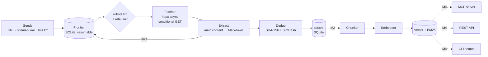

# Docs-Spider (DocuRAG)

[](https://github.com/uzairharoon-dev/Docs-Spider/actions/workflows/ci.yml)


**Up-to-date, versioned library docs for AI coding assistants. Self-hosted, and it works on private docs too.**

AI coding assistants stop learning at their training cutoff. As a result they suggest
deprecated APIs, mix up library versions, and know nothing about your team's internal docs.

DocuRAG (working name) fixes that. It:

1. **crawls** any docs site, such as FastAPI, Next.js or your company wiki,
2. **indexes** the pages by version, and
3. **serves** them to Claude Code, Cursor and other assistants through an MCP server.

The assistant then answers from current docs and cites them.

```
You:        How do I declare cookie parameters in FastAPI?
Assistant:  (calls search_docs("cookie parameters", library="fastapi"))
            Use Annotated[str | None, Cookie()] ...
            Source: https://fastapi.tiangolo.com/tutorial/cookie-params/ > Cookie Parameters
```

---

## Why not just use Context7?

[Context7](https://context7.com) solves this well for public libraries. DocuRAG adds three things:

| | Context7 | DocuRAG |
| --- | --- | --- |
| Hosting | Hosted service | **Self-hosted**: runs on your laptop or your servers |
| Private / internal docs | No | **Yes**: point it at any URL your machine can reach |
| Retrieval quality | Not published | **Measured**: Recall@k and MRR on a public eval set (M3) |

---

## Status

The project is built in milestones. **M1 (the crawler) is done.**

| # | Deliverable | Status |
| --- | --- | --- |
| M1 | Async crawler, robots.txt, resumable frontier, HTML to Markdown | ✅ Done |
| M2 | Heading-aware chunker, embedder, vector index, `docurag search` | ⏳ Next |
| M3 | Hybrid search (vector + BM25), reranker, eval harness | Planned |
| M4 | MCP server, REST API, Docker Compose | Planned |
| M5 | Full incremental re-crawl, version detection, Playwright for JS sites | Planned |
| M6 | Demo GIF, benchmarks, docs site | Planned |

Today you can crawl a docs site into clean, deduplicated Markdown, keep it fresh,
and read any page back. Search and MCP serving come in M2–M4.

---

## Quickstart

Requires Python 3.12+ and [uv](https://docs.astral.sh/uv/).

```bash
git clone https://github.com/uzairharoon-dev/Docs-Spider.git
cd Docs-Spider
uv sync

# Crawl the FastAPI tutorial
uv run docurag add https://fastapi.tiangolo.com/ --name fastapi --include /tutorial/

# See what was indexed
uv run docurag libraries
uv run docurag page https://fastapi.tiangolo.com/tutorial/first-steps/

# Later: re-crawl. Unchanged pages are skipped.
uv run docurag update fastapi
```

> **Windows / Git Bash:** Git Bash turns arguments like `/tutorial/` into file paths
> (`C:/Program Files/Git/tutorial/`). Run `export MSYS_NO_PATHCONV=1` first, or use PowerShell.

---

## Features (M1)

### Crawling
- **Many kinds of seed.** Start from a page URL, a `sitemap.xml` (including sitemap indexes
  and `.xml.gz`) or an `llms.txt`. Sitemaps listed in `robots.txt` are found automatically.
- **Tight scope.** The crawl stays on the start URL's host and under its path prefix.
  `exclude` and `include` patterns (substring or glob) narrow it further.
- **Polite by default.** Obeys `robots.txt` per RFC 9309 and honors `Crawl-delay`.
  Defaults to 2 requests/second per domain. Retries 429/5xx with backoff and `Retry-After`.
- **Resumable.** The frontier and job state live in SQLite. Stop a crawl with Ctrl-C,
  or let it crash, then run the same command again: it continues the same job and
  does not refetch finished pages.
- **Cheap re-crawls.** `update` sends `If-None-Match` / `If-Modified-Since`.
  A `304 Not Modified` costs one request and still follows the page's stored links.

### Extraction
- **Finds the main content.** Recognises MkDocs Material, Sphinx, Docusaurus and generic
  `<article>`/`<main>` layouts.
- **Strips page chrome.** Removes navigation, sidebars, footers, tables of contents,
  breadcrumbs, cookie banners, heading permalinks and line numbers.
- **Keeps the useful parts.** Headings, tables and code blocks survive, and code blocks keep
  their language tag (`language-*`, `highlight-*`, `data-lang`). Links become absolute URLs.
- **Markdown in, Markdown out.** `.md` pages (common in `llms.txt`) are stored as they are.
- **Deduplication.** Exact copies are caught by SHA-256. Near-duplicates are caught by
  64-bit SimHash (Hamming distance ≤ 3, using a banded index).

---

## CLI reference

| Command | Description |
| --- | --- |
| `docurag add URL --name NAME` | Add a library and crawl it. Re-running resumes an unfinished crawl. |
| `docurag update NAME` | Re-crawl a library incrementally. |
| `docurag libraries` | List libraries with page counts and versions. |
| `docurag jobs [NAME]` | Show recent crawl jobs and their stats. |
| `docurag page URL [--raw]` | Print the stored Markdown for a page. |
| `docurag remove NAME` | Delete a library and all its pages. |
| `docurag version` | Print the version. |

Options for `add`:

| Option | Default | Description |
| --- | --- | --- |
| `--include, -i` | — | Keep only paths that match. Repeatable. |
| `--exclude, -x` | — | Skip paths that match. Repeatable. |
| `--max-pages` | unlimited | Stop after this many fetches. |
| `--max-depth` | 20 | Maximum link depth from the start page. |
| `--rate-limit` | 2 | Requests per second per domain. |
| `--version` | `latest` | Version label stored with the pages. |
| `--no-sitemap` | off | Don't auto-discover sitemaps. |
| `--fresh` | off | Start a new job instead of resuming. |

Global options: `--config/-c PATH` and `--verbose/-v`.

---

## Configuration

DocuRAG reads `docurag.yaml` from the current directory, or the file given with `--config`.
CLI flags override it.

```yaml
# data_dir: ~/.docurag        # SQLite database location (or set DOCURAG_HOME)
concurrency: 16              # concurrent fetches across all domains

libraries:
  - name: fastapi
    start_urls: [https://fastapi.tiangolo.com/]
    include: ["/tutorial/", "/advanced/"]
    exclude: ["/zh/", "/ja/"]
    render_js: false          # Playwright fallback arrives in M5
    rate_limit: 2
    # max_pages: 500
    # max_depth: 20
    # version: latest
    # discover_sitemaps: true
    # scope_prefixes: ["/docs/"]   # default: derived from start_urls
```

Data is stored in `~/.docurag/docurag.db` unless `DOCURAG_HOME` or `data_dir` says otherwise.

---

## Architecture



Solid lines exist today. Dotted lines are planned.

### Data model

| Table | Key fields |
| --- | --- |
| `libraries` | `name`, `base_url`, `config_json` |
| `pages` | `library_id`, `version`, `url`, `title`, `markdown`, `content_hash`, `simhash`, `etag`, `last_modified`, `links_json`, `fetched_at` |
| `crawl_jobs` | `library_id`, `status` (running / completed / interrupted / failed), `pages_done`, `stats_json` |
| `crawl_errors` | `job_id`, `url`, `error` |
| `frontier` | `job_id`, `url`, `depth`, `status`, `attempts` |

---

## Project layout

```
docurag/
  config.py           settings and docurag.yaml loading
  db.py               SQLite schema and queries
  urls.py             URL normalization and crawl scope
  crawler/
    crawler.py        orchestration: workers, budget, outcomes
    fetcher.py        httpx fetch with retries and size limits
    frontier.py       persistent BFS queue
    ratelimit.py      per-domain request spacing
    robots.py         robots.txt cache (RFC 9309)
    seeds.py          sitemap.xml / llms.txt expansion
  extract/
    cleaner.py        main-content detection, chrome removal
    markdown.py       HTML to Markdown with tagged code fences
    dedup.py          SHA-256 + SimHash duplicate detection
  serve/cli.py        Typer CLI
  index/  eval/       M2 / M3
tests/                pytest suite, using an in-memory fake docs site
```

---

## Evaluation plan (M3)

Retrieval quality will be measured, not assumed:

- An eval set of 50–100 question / source-section pairs across several libraries.
- Recall@5 and MRR for vector-only, BM25-only, hybrid, and hybrid with reranker.
- Target: **Recall@5 ≥ 0.85**, with search **p95 < 300 ms** when no reranker is used.

The results table will be published here.

---

## Development

```bash
uv sync                 # install with dev dependencies
uv run pytest           # run the test suite
uv run ruff check .     # lint
```

The tests serve a fake docs site through `httpx.MockTransport`, so they never touch the
network. They cover robots rules, redirects, duplicates, conditional re-crawls, the
`include` filter, `max_pages` and resuming after an interruption.

CI runs lint and tests on Ubuntu and Windows (`.github/workflows/ci.yml`).

---

## Known limitations

- Search and MCP serving are not built yet (M2–M4).
- JavaScript-rendered sites need Playwright (M5). Today `render_js: true` only logs a warning.
- Code blocks have a language tag only when the site's HTML provides one.
  FastAPI's HTML does not, so its code fences are untagged.
- Versions come only from the `--version` label. Detection from URLs is planned for M5.

## License

MIT
