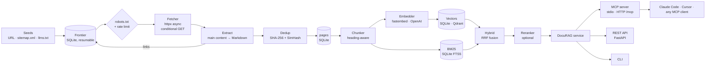

# Docs-Spider (DocuRAG)

[](https://github.com/uzairharoon-dev/Docs-Spider/actions/workflows/ci.yml)


**Up-to-date, versioned library docs for AI coding assistants. Self-hosted, and it works on private docs too.**

AI coding assistants stop learning at their training cutoff. As a result they suggest
deprecated APIs, mix up library versions, and know nothing about your team's internal docs.

DocuRAG (working name) fixes that. It:

1. **crawls** any docs site, such as FastAPI, Next.js or your company wiki,
2. **indexes** the pages by version, and
3. **serves** them to Claude Code, Cursor and other assistants through an MCP server.

The assistant then answers from current docs and cites them.

```
You:        How do I declare cookie parameters in FastAPI?
Assistant:  (calls search_docs("cookie parameters", library="fastapi"))
            Use Annotated[str | None, Cookie()] ...
            Source: https://fastapi.tiangolo.com/tutorial/cookie-params/ > Cookie Parameters
```

---

## Why not just use Context7?

[Context7](https://context7.com) solves this well for public libraries. DocuRAG adds three things:

| | Context7 | DocuRAG |
| --- | --- | --- |
| Hosting | Hosted service | **Self-hosted**: runs on your laptop or your servers |
| Private / internal docs | No | **Yes**: point it at any URL your machine can reach |
| Retrieval quality | Not published | **Measured**: Recall@5 = 0.94 on a public 84-question eval set ([details](#evaluation)) |

---

## Status

The project is built in milestones. **M1–M5 are done:** crawler, chunking and embeddings, hybrid search with a measured eval, the MCP server, REST API and Docker setup, and versioned docs, incremental re-crawls and JavaScript-rendered sites.

| # | Deliverable | Status |
| --- | --- | --- |
| M1 | Async crawler, robots.txt, resumable frontier, HTML to Markdown | ✅ Done |
| M2 | Heading-aware chunker, embedder, vector index, `docurag search` | ✅ Done |
| M3 | Hybrid search (vector + BM25), reranker, eval harness | ✅ Done |
| M4 | MCP server, REST API, Docker Compose | ✅ Done |
| M5 | Full incremental re-crawl, version detection, Playwright for JS sites | ✅ Done |
| M6 | Demo GIF, benchmarks, docs site | ⏳ Next |

Today you can crawl a docs site, keep it fresh, and let Claude Code, Cursor or any MCP
client search it, with cited results. A REST API and `docker compose up` cover the rest.

---

## Quickstart

Requires Python 3.12+ and [uv](https://docs.astral.sh/uv/).

```bash
git clone https://github.com/uzairharoon-dev/Docs-Spider.git
cd Docs-Spider
uv sync

# Crawl and index the FastAPI tutorial
uv run docurag add https://fastapi.tiangolo.com/ --name fastapi --include /tutorial/

# Search it
uv run docurag search "dependency injection" --lib fastapi

# See what was indexed
uv run docurag libraries
uv run docurag page https://fastapi.tiangolo.com/tutorial/first-steps/

# Later: re-crawl and re-index. Unchanged pages are skipped.
uv run docurag update fastapi
```

The first `add` downloads the default embedding model (`BAAI/bge-small-en-v1.5`, ~70 MB)
into `~/.docurag/models`. Everything runs locally on CPU: no API key, no server.

> **Windows / Git Bash:** Git Bash turns arguments like `/tutorial/` into file paths
> (`C:/Program Files/Git/tutorial/`). Run `export MSYS_NO_PATHCONV=1` first, or use PowerShell.

### Or with Docker

```bash
docker compose up -d                       # API + MCP on http://localhost:8000
curl -X POST localhost:8000/crawl -H 'content-type: application/json' \
     -d '{"name": "fastapi", "url": "https://fastapi.tiangolo.com/", "include": ["/tutorial/"]}'
curl localhost:8000/jobs/1                 # wait for "status": "completed", "index": "done"
```

Data and model files live in the `docurag-data` volume. `docurag.yaml` is mounted read-only.

---

## Use it from your AI assistant

DocuRAG is an [MCP](https://modelcontextprotocol.io) server with three tools:

| Tool | What it returns |
| --- | --- |
| `search_docs(query, library?, version?, k?)` | The most relevant sections as Markdown, each with a `Source: url#section` citation |
| `list_libraries()` | Indexed libraries with versions, page and chunk counts |
| `get_page(url, max_chars?)` | A whole page as Markdown |

The server also sends instructions telling the assistant to check `list_libraries`, search
before answering, and cite its sources.

**Claude Code**, local (stdio):

```bash
claude mcp add docurag -- uv run --directory /path/to/Docs-Spider docurag serve --mcp
```

**Claude Code**, against a running server or the Docker container (HTTP):

```bash
claude mcp add --transport http docurag http://localhost:8000/mcp
# with DOCURAG_API_KEY set: add  --header "Authorization: Bearer $DOCURAG_API_KEY"
```

**Cursor** (`.cursor/mcp.json`) and other MCP clients:

```json
{
  "mcpServers": {
    "docurag": {
      "command": "uv",
      "args": ["run", "--directory", "/path/to/Docs-Spider", "docurag", "serve", "--mcp"]
    }
  }
}
```

or `{"mcpServers": {"docurag": {"url": "http://localhost:8000/mcp"}}}` for the HTTP server.

## REST API

`docurag serve` (or the Docker image) starts the API on port 8000. OpenAPI docs are at `/docs`.

| Endpoint | Description |
| --- | --- |
| `POST /search` | `{"query", "library"?, "version"?, "k"?, "mode"?, "rerank"?}` → cited results with every retriever's score |
| `POST /crawl` | `{"name", "url"?, "include"?, "exclude"?, "max_pages"?, ...}` → `202 {"job_id"}`; crawls and then indexes in the background |
| `GET /jobs/{id}` | Job status, crawl stats, errors and indexing state |
| `GET /libraries` | Indexed libraries |
| `GET /pages?url=` | One page as Markdown |
| `GET /health` | Liveness (never needs a key) |
| `/mcp` | MCP over streamable HTTP |

```bash
curl -s -X POST localhost:8000/search -H 'content-type: application/json' \
     -d '{"query": "set a cookie on the response", "library": "fastapi", "k": 3}'
```

> **Security:** the server binds to `127.0.0.1` by default. `POST /crawl` makes the server
> fetch any URL you give it, so before exposing the port set `DOCURAG_API_KEY`. Every route
> except `/health`, `/mcp` included, then requires `Authorization: Bearer <key>`.

---

## Features

### Crawling
- **Many kinds of seed.** Start from a page URL, a `sitemap.xml` (including sitemap indexes
  and `.xml.gz`) or an `llms.txt`. Sitemaps listed in `robots.txt` are found automatically.
- **Tight scope.** The crawl stays on the start URL's host and under its path prefix.
  `exclude` and `include` patterns (substring or glob) narrow it further.
- **Polite by default.** Obeys `robots.txt` per RFC 9309 and honors `Crawl-delay`.
  Defaults to 2 requests/second per domain. Retries 429/5xx with backoff and `Retry-After`.
- **Resumable.** The frontier and job state live in SQLite. Stop a crawl with Ctrl-C,
  or let it crash, then run the same command again: it continues the same job and
  does not refetch finished pages.
- **Cheap re-crawls.** `update` skips pages whose sitemap `<lastmod>` is older than the
  last fetch, without sending a request at all. For the rest it sends `If-None-Match` /
  `If-Modified-Since`: a `304 Not Modified` costs one request. Either way the page's stored
  links are still followed. Re-crawling the 23-page httpx docs fetched zero pages.
  `update --full` ignores `<lastmod>` for sites whose sitemaps carry stale dates.
- **Removed pages disappear.** A page that now returns 404/410 is hidden from search at once
  and deleted, with its chunks and vectors, at the next index. If it comes back, so does it.
- **Versions.** The version is read from the URL: `/0.115/`, `/v2/`, `/3.12/`, `/en/stable/`.
  Use `--version-pattern` for unusual layouts, or `--version 2.0` to label a whole crawl.
  Duplicate detection runs per version, so near-identical v1 and v2 pages are both kept.
  Searching with `version: latest` picks the newest release that is indexed.
- **JavaScript-rendered sites.** `--render-js auto` re-renders pages in headless Chromium
  when their static HTML is an empty app shell; `on` renders every page. Needs the `js`
  extra: `uv sync --extra js && uv run playwright install chromium`.

### Extraction
- **Finds the main content.** Recognises MkDocs Material, Sphinx, Docusaurus and generic
  `<article>`/`<main>` layouts.
- **Strips page chrome.** Removes navigation, sidebars, footers, tables of contents,
  breadcrumbs, cookie banners, heading permalinks and line numbers.
- **Keeps the useful parts.** Headings, tables and code blocks survive, and code blocks keep
  their language tag (`language-*`, `highlight-*`, `data-lang`). Links become absolute URLs.
- **Markdown in, Markdown out.** `.md` pages (common in `llms.txt`) are stored as they are.
- **Deduplication.** Exact copies are caught by SHA-256. Near-duplicates are caught by
  64-bit SimHash (Hamming distance ≤ 3, using a banded index).
- **Section anchors.** Heading `id`s are kept, so results can cite `page#section`.

### Chunking
- **Follows the heading tree.** Each chunk records its heading path, such as
  `Security > OAuth2 > Scopes`, and the path is embedded with the text.
- **Sized for the model.** 300–512 tokens by default (configurable within the spec's 300–800),
  which fits bge-small's 512-token input. Large sections are split on paragraph, sentence
  or table-row boundaries with ~12% overlap; table headers repeat in every piece.
- **Code stays whole.** A fenced code block is never split, even when it exceeds the limit.
- **No orphan fragments.** Small neighbouring sections merge under their common parent heading.

### Embedding and indexing
- **Pluggable embedders.** `local` (fastembed, ONNX on CPU), `openai` (any OpenAI-compatible
  `/embeddings` API) or `hash` (offline, for tests).
- **Pluggable vector stores.** `sqlite` (default: vectors stored next to the metadata,
  searched with numpy, no server) or `qdrant` (server or embedded).
- **Incremental indexing.** Only pages whose content or embedding model changed are re-chunked
  and re-embedded.

### Search
- **Hybrid by default.** Dense vectors and BM25 (SQLite FTS5, Porter stemming) each return
  their top 50, merged with reciprocal rank fusion. Exact API names like `jsonable_encoder`
  are found by keywords; paraphrased questions are found by meaning.
- **Optional reranker.** `--rerank` re-orders the top 20 with a cross-encoder
  (`ms-marco-MiniLM-L-6-v2`, 80 MB, local).
- **Three modes.** `--mode vector | bm25 | hybrid`. BM25 needs no model at all.
- **Cited results.** Every hit carries its library, version, section path,
  `url#anchor` citation and each retriever's score. `--json` gives machine-readable output.

---

## CLI reference

| Command | Description |
| --- | --- |
| `docurag add URL --name NAME` | Add a library, crawl it and index it. Re-running resumes an unfinished crawl. |
| `docurag update NAME [--full]` | Re-crawl and re-index incrementally. `--full` ignores sitemap `<lastmod>`. |
| `docurag index [NAME] [--force]` | Chunk and embed new or changed pages (all libraries by default). |
| `docurag search QUERY --lib NAME` | Search. Options: `--mode`, `--rerank`, `--version`, `-k`, `--json`, `--full`. |
| `docurag eval` | Run the retrieval eval: Recall@k, MRR and latency per search mode. |
| `docurag serve [--host] [--port]` | REST API with MCP mounted at `/mcp` (default `127.0.0.1:8000`). |
| `docurag serve --mcp` | MCP server over stdio, for Claude Code, Cursor and other MCP clients. |
| `docurag libraries` | List libraries with page, indexed-page and chunk counts. |
| `docurag jobs [NAME]` | Show recent crawl jobs and their stats. |
| `docurag page URL [--raw]` | Print the stored Markdown for a page. |
| `docurag remove NAME` | Delete a library and all its pages. |
| `docurag version` | Print the version. |

Options for `add`:

| Option | Default | Description |
| --- | --- | --- |
| `--include, -i` | — | Keep only paths that match. Repeatable. |
| `--exclude, -x` | — | Skip paths that match. Repeatable. |
| `--max-pages` | unlimited | Stop after this many fetches. |
| `--max-depth` | 20 | Maximum link depth from the start page. |
| `--rate-limit` | 2 | Requests per second per domain. |
| `--version` | `latest` | Label every page with this version (turns off detection). |
| `--version-pattern` | — | Regex with one group that reads the version from the URL path. |
| `--render-js` | `off` | `auto` renders JS-shell pages in Chromium, `on` renders all. |
| `--no-sitemap` | off | Don't auto-discover sitemaps. |
| `--fresh` | off | Start a new job instead of resuming. |
| `--no-index` | off | Crawl only; run `docurag index` later. |

Global options: `--config/-c PATH` and `--verbose/-v`.

---

## Configuration

DocuRAG reads `docurag.yaml` from the current directory, or the file given with `--config`.
CLI flags override it.

```yaml
# data_dir: ~/.docurag        # SQLite database location (or set DOCURAG_HOME)
concurrency: 16              # concurrent fetches across all domains

libraries:
  - name: fastapi
    start_urls: [https://fastapi.tiangolo.com/]
    include: ["/tutorial/", "/advanced/"]
    exclude: ["/zh/", "/ja/"]
    render_js: false          # false | auto | true (auto/true need the `js` extra)
    rate_limit: 2
    # max_pages: 500
    # max_depth: 20
    # version: latest          # a fixed label for every page turns detection off
    # version_detection: auto  # auto | off
    # version_pattern: '^/docs/(?P<version>[^/]+)/'
    # discover_sitemaps: true
    # trust_sitemap_lastmod: true
    # scope_prefixes: ["/docs/"]   # default: derived from start_urls

embedder:
  provider: local             # local | openai | hash
  model: BAAI/bge-small-en-v1.5
  # provider: openai
  # model: text-embedding-3-small
  # base_url: https://api.openai.com/v1   # any OpenAI-compatible endpoint
  # api_key_env: OPENAI_API_KEY

store:
  type: sqlite                # no server needed
  # type: qdrant
  # url: http://localhost:6333   # omit to run Qdrant embedded under data_dir

chunking: {min_tokens: 300, max_tokens: 512, overlap: 0.12}

search:
  mode: hybrid                # vector | bm25 | hybrid
  candidates: 50              # per retriever, before fusion
  rrf_k: 60
  rerank: false
  reranker_model: Xenova/ms-marco-MiniLM-L-6-v2
  rerank_candidates: 20
```

Changing the embedder re-indexes pages on the next `index` / `update`; vectors from
different models are never mixed. Qdrant needs the extra: `uv sync --extra qdrant`.

Data is stored in `~/.docurag/docurag.db` unless `DOCURAG_HOME` or `data_dir` says otherwise.

---

## Architecture



The REST API and the MCP server share one service. It loads models once, serialises use of
the read connection, and runs each crawl as a background task with its own SQLite connection,
so searches keep working while a crawl writes.

### Data model

| Table | Key fields |
| --- | --- |
| `libraries` | `name`, `base_url`, `config_json` |
| `pages` | `library_id`, `version`, `url`, `title`, `markdown`, `content_hash`, `simhash`, `etag`, `last_modified`, `links_json`, `anchors_json`, `indexed_hash`, `indexed_model`, `fetched_at` |
| `crawl_jobs` | `library_id`, `status` (running / completed / interrupted / failed), `pages_done`, `stats_json` |
| `crawl_errors` | `job_id`, `url`, `error` |
| `frontier` | `job_id`, `url`, `depth`, `status`, `attempts` |
| `chunks` | `page_id`, `library_id`, `version`, `position`, `heading_path`, `anchor`, `context`, `text`, `token_count` |
| `chunks_fts` | FTS5 index over `chunks.text` and `chunks.context`, kept in sync by triggers |
| `chunk_vectors` | `chunk_id`, `model`, `library_id`, `version`, `vector` (sqlite store only) |

---

## Project layout

```
docurag/
  config.py           settings and docurag.yaml loading
  db.py               SQLite schema and queries
  urls.py             URL normalization and crawl scope
  crawler/
    crawler.py        orchestration: workers, budget, outcomes
    fetcher.py        httpx fetch with retries and size limits
    frontier.py       persistent BFS queue
    ratelimit.py      per-domain request spacing
    robots.py         robots.txt cache (RFC 9309)
    seeds.py          sitemap.xml (with lastmod) / llms.txt expansion
    versions.py       version detection from URLs, "latest" resolution
    renderer.py       optional Playwright rendering for JS-built pages
  extract/
    cleaner.py        main-content detection, chrome removal
    markdown.py       HTML to Markdown with tagged code fences
    dedup.py          SHA-256 + SimHash duplicate detection
  index/
    chunker.py        heading-aware Markdown chunking
    embedder.py       local / OpenAI-compatible / hash embedders
    store.py          sqlite (numpy) and Qdrant vector stores
    pipeline.py       incremental pages -> chunks -> vectors
    hybrid.py         BM25 over SQLite FTS5, reciprocal rank fusion
    rerank.py         optional cross-encoder reranker
    search.py         vector / bm25 / hybrid search, cited hits
  eval/
    run_eval.py       Recall@k, MRR and latency per configuration
    dataset/          questions.jsonl: the bundled eval set
    corpus.yaml       the docs the eval set is answered from
  serve/
    service.py        shared service: models, search, background crawl + index jobs
    mcp_server.py     MCP tools: search_docs, list_libraries, get_page
    api.py            FastAPI REST API, MCP mounted at /mcp, optional API key
    cli.py            Typer CLI
Dockerfile, docker-compose.yml
tests/                pytest suite, using an in-memory fake docs site
```

---

## Evaluation

Retrieval quality is measured, not assumed. The bundled eval set has **84 questions** over
three docs sites: FastAPI (40), httpx (20) and Typer (24). The questions are phrased the way a
developer asks an assistant ("My React app on localhost:3000 gets blocked when calling the
API"), not copied from page headings, so keyword matching gets no free ride. Each question lists
every page that answers it.

Results (crawled 2026-11-13; 167 pages, 1,008 chunks; `bge-small-en-v1.5`; k = 10):

| Config | Recall@1 | Recall@3 | Recall@5 | Recall@10 | MRR@10 | p50 ms | p95 ms |
| --- | ---: | ---: | ---: | ---: | ---: | ---: | ---: |
| vector | 0.762 | 0.881 | 0.917 | 0.952 | 0.832 | 34 | 114 |
| bm25 | 0.643 | 0.786 | 0.881 | 0.940 | 0.736 | 7 | 15 |
| **hybrid** (default) | **0.774** | **0.917** | **0.940** | **0.976** | **0.847** | 49 | 105 |
| hybrid + rerank | 0.798 | 0.905 | 0.952 | 0.976 | 0.855 | 3241 | 4819 |

- **Hybrid beats either retriever alone** on every metric. BM25 and vectors miss different
  questions, so fusing them recovers most of each one's misses.
- **Targets met:** Recall@5 0.940 against a target of ≥ 0.85; p95 105 ms against < 300 ms.
- **The reranker** adds a little at the top (Recall@1 +0.024, MRR +0.008) but costs seconds per
  query on the CPU used here, which is a slow one (about 1,800 tokens/s for bge-small). It
  stays opt-in.
- Latency is one CLI-process search call, query embedding included, measured on the same
  machine. Raw per-question results: `docurag/eval/results/2026-11-13.json`.

How the metrics work: a hit is relevant when its page URL is one of the question's expected
pages. Recall@k is the share of questions with a relevant hit in the top k. MRR@10 is the mean
of 1 / rank of the first relevant hit.

One label was corrected after the first run. Typer's "Nested SubCommands" page also answers
`ty-17` and had been left out of its expected pages. No other labels were changed after
seeing results.

Reproduce it (about 10 minutes of crawling and embedding on a laptop):

```bash
export DOCURAG_HOME=~/.docurag-eval        # keep the corpus apart from your own libraries
for lib in fastapi httpx typer; do uv run docurag -c docurag/eval/corpus.yaml update $lib; done
uv run docurag -c docurag/eval/corpus.yaml eval --out results.json
uv run docurag -c docurag/eval/corpus.yaml eval --configs hybrid   # faster: skip the reranker
```

Docs sites change, so expect small drifts from the table above.

---

## Development

```bash
uv sync                 # install with dev dependencies
uv run pytest           # run the test suite
uv run ruff check .     # lint
```

The tests serve a fake docs site through `httpx.MockTransport`, so they never touch the
network. They cover robots rules, redirects, duplicates, conditional re-crawls, the
`include` filter, `max_pages`, resuming after an interruption, chunk boundaries, both
vector stores, incremental indexing, BM25/FTS5 sync and migration, rank fusion, reranking,
the eval metrics, the REST API, the MCP tools (in memory and as a real stdio
subprocess) and the CLI. They use the `hash` embedder, so no
model download is needed.

CI runs lint and tests on Ubuntu and Windows, and builds the Docker image
(`.github/workflows/ci.yml`).

---

## Known limitations

- The Docker image is about 1 GB, mostly onnxruntime and numpy.
- Crawls started through the API are not resumed after a server restart; the next
  `POST /crawl` for that library resumes the interrupted job.
- The reranker is slow on weak CPUs; it stays off by default.
- Pages crawled before section anchors existed get them only when their content changes
  (a `304 Not Modified` carries no HTML). `docurag remove` + `add` refreshes them.
- Rendering in Chromium is slower than plain HTTP, and the browser's own sub-requests
  (scripts, XHR) are not counted against the per-domain rate limit.
- The Docker image has no browser by default; build with `DOCURAG_WITH_JS=true docker compose
  build` to enable `render_js` (about 3 GB instead of 1 GB: Chromium and its system libraries).
- Code blocks have a language tag only when the site's HTML provides one.
  FastAPI's HTML does not, so its code fences are untagged.
- Version detection looks at the first three directory levels only, so `/api/v1/`
  reference paths deeper in a site aren't mistaken for docs versions.

## License

MIT
