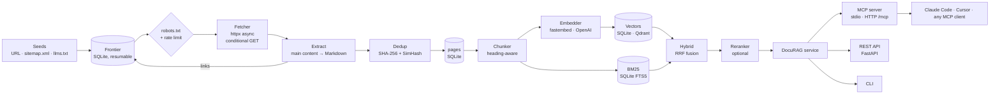

# How it works



The REST API and the MCP server share one service. It loads models once, serialises use of
the read connection, and runs each crawl as a background task with its own SQLite connection,
so searches keep working while a crawl writes.

## Crawling

- **Many kinds of seed.** Start from a page URL, a `sitemap.xml` (including sitemap indexes
  and `.xml.gz`) or an `llms.txt`. Sitemaps listed in `robots.txt` are found automatically.
- **Tight scope.** The crawl stays on the start URL's host and under its path prefix.
  `exclude` and `include` patterns (substring or glob) narrow it further.
- **Polite by default.** Obeys `robots.txt` per RFC 9309 and honors `Crawl-delay`.
  Defaults to 2 requests/second per domain. Retries 429/5xx with backoff and `Retry-After`.
- **Fair across domains.** Within a link depth, the frontier hands out URLs round-robin by
  host, so workers don't all queue behind one domain's rate limit while others sit idle.
- **Uses more than one core.** HTML-to-Markdown extraction runs in a small process pool, so
  parsing doesn't stall the fetch loop.
- **Resumable.** The frontier and job state live in SQLite. Stop a crawl with Ctrl-C, or let
  it crash, then run the same command again: it continues the same job and does not refetch
  finished pages.
- **Cheap re-crawls.** `update` skips pages whose sitemap `<lastmod>` is older than the last
  fetch, without sending a request at all. For the rest it sends `If-None-Match` /
  `If-Modified-Since`: a `304 Not Modified` costs one request. Either way the page's stored
  links are still followed. Re-crawling the 23-page httpx docs fetched zero pages.
- **Removed pages disappear.** A page that now returns 404/410 is hidden from search at once
  and deleted, with its chunks and vectors, at the next index. If it comes back, so does it.
- **Versions.** The version is read from the URL: `/0.115/`, `/v2/`, `/3.12/`, `/en/stable/`.
  Use `--version-pattern` for unusual layouts, or `--version 2.0` to label a whole crawl.
  Duplicate detection runs per version, so near-identical v1 and v2 pages are both kept.
  Searching with `version: latest` picks the newest release that is indexed.
- **JavaScript-rendered sites.** `--render-js auto` re-renders pages in headless Chromium
  when their static HTML is an empty app shell; `on` renders every page.

## Extraction

- **Finds the main content.** Recognises MkDocs Material, Sphinx, Docusaurus and generic
  `<article>`/`<main>` layouts.
- **Strips page chrome.** Removes navigation, sidebars, footers, tables of contents,
  breadcrumbs, cookie banners, heading permalinks and line numbers.
- **Keeps the useful parts.** Headings, tables and code blocks survive, and code blocks keep
  their language tag (`language-*`, `highlight-*`, `data-lang`). Links become absolute URLs.
- **Markdown in, Markdown out.** `.md` pages (common in `llms.txt`) are stored as they are.
- **Deduplication.** Exact copies are caught by SHA-256. Near-duplicates are caught by 64-bit
  SimHash (Hamming distance ≤ 3, using a banded index).
- **Section anchors.** Heading `id`s are kept, so results can cite `page#section`.

## Chunking

- **Follows the heading tree.** Each chunk records its heading path, such as
  `Security > OAuth2 > Scopes`, and the path is embedded with the text.
- **Sized for the model.** 300–512 tokens by default, which fits bge-small's 512-token input.
  Large sections are split on paragraph, sentence or table-row boundaries with ~12% overlap;
  table headers repeat in every piece.
- **Code stays whole.** A fenced code block is never split, even when it exceeds the limit.
- **No orphan fragments.** Small neighbouring sections merge under their common parent heading.

## Embedding and indexing

- **Pluggable embedders.** `local` (fastembed, ONNX on CPU), `openai` (any OpenAI-compatible
  `/embeddings` API) or `hash` (offline, for tests).
- **Pluggable vector stores.** `sqlite` (default: vectors stored next to the metadata,
  searched with numpy, no server) or `qdrant` (server or embedded).
- **Incremental indexing.** Only pages whose content or embedding model changed are re-chunked
  and re-embedded.

## Search

- **Hybrid by default.** Dense vectors and BM25 (SQLite FTS5, Porter stemming) each return
  their top 50, merged with reciprocal rank fusion. Exact API names like `jsonable_encoder`
  are found by keywords; paraphrased questions are found by meaning.
- **Optional reranker.** `--rerank` re-orders the top 20 with a cross-encoder
  (`ms-marco-MiniLM-L-6-v2`, 80 MB, local).
- **Cited results.** Every hit carries its library, version, section path, `url#anchor`
  citation and each retriever's score.

## Data model

| Table | Key fields |
| --- | --- |
| `libraries` | `name`, `base_url`, `config_json` |
| `pages` | `library_id`, `version`, `url`, `title`, `markdown`, `content_hash`, `simhash`, `etag`, `last_modified`, `links_json`, `anchors_json`, `indexed_hash`, `indexed_model`, `fetched_at` |
| `crawl_jobs` | `library_id`, `status` (running / completed / interrupted / failed), `pages_done`, `stats_json` |
| `crawl_errors` | `job_id`, `url`, `error` |
| `frontier` | `job_id`, `url`, `depth`, `host_rank`, `status`, `attempts` |
| `chunks` | `page_id`, `library_id`, `version`, `position`, `heading_path`, `anchor`, `context`, `text`, `token_count` |
| `chunks_fts` | FTS5 index over `chunks.text` and `chunks.context`, kept in sync by triggers |
| `chunk_vectors` | `chunk_id`, `model`, `library_id`, `version`, `vector` (sqlite store only) |

## Project layout

```
docurag/
  config.py           settings and docurag.yaml loading
  db.py               SQLite schema and queries
  urls.py             URL normalization and crawl scope
  crawler/            crawler, fetcher, frontier, rate limit, robots, seeds, versions, renderer
  extract/            main-content cleaning, HTML to Markdown, SHA-256 + SimHash dedup
  index/              chunker, embedders, vector stores, indexing pipeline, BM25 + RRF, reranker
  eval/               eval runner, 84-question dataset, corpus config, results
  serve/              shared service, MCP server, REST API, CLI
benchmarks/           crawl and search benchmarks with recorded results
docs/                 this site (MkDocs Material)
tests/                pytest suite, using an in-memory fake docs site
```
